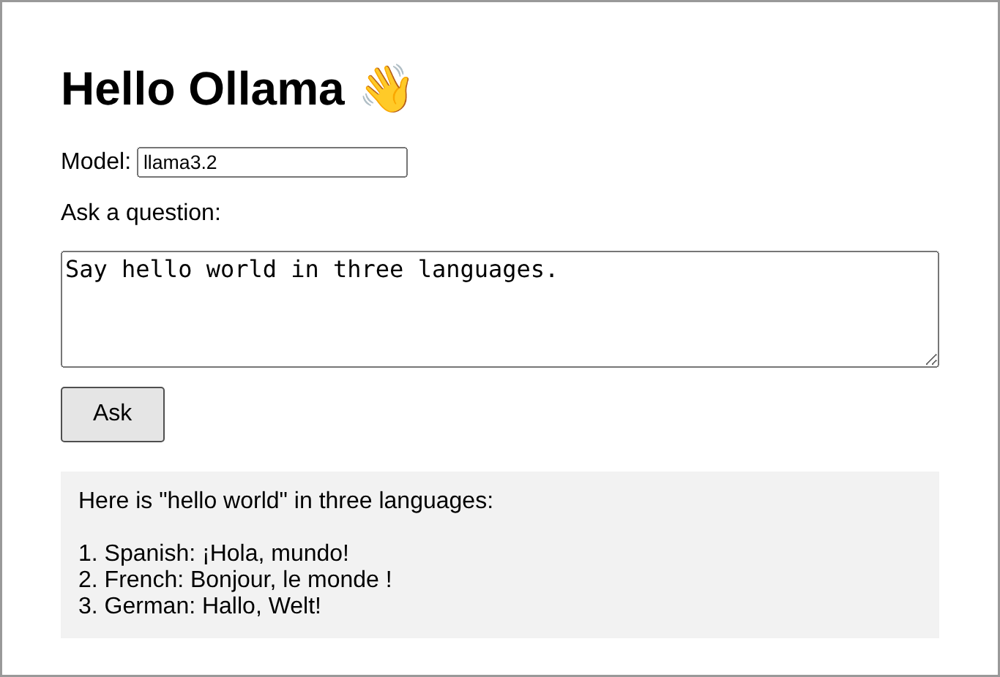

# Hello Ollama (minimal example)

The smallest possible browser GUI for Ollama: one HTML file, no dependencies, one call to
Ollama's `POST /api/generate` REST endpoint with `"stream": false`.

**Step-by-step guide with screenshots:** [`Hello-Ollama-Guide.docx`](Hello-Ollama-Guide.docx)

Quick start:

```bash
ollama pull llama3.2
cd hello-world
python -m http.server 8000      # then open http://localhost:8000
```

Serving from `http://localhost` matters: Ollama accepts browser requests from localhost origins by
default, but not from a file opened by double-clicking (see the guide's Troubleshooting section).


